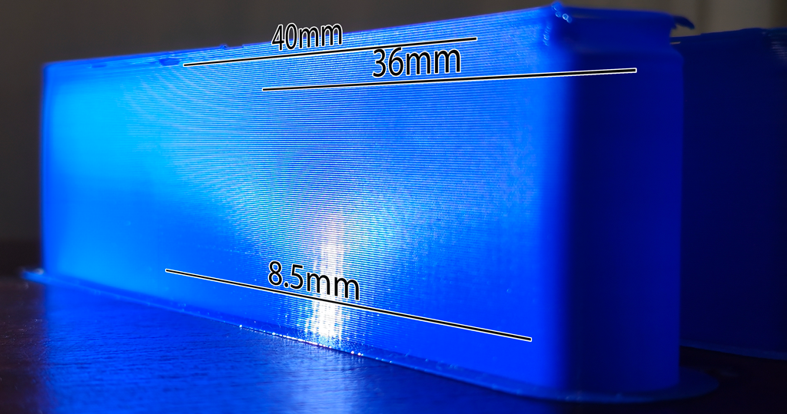
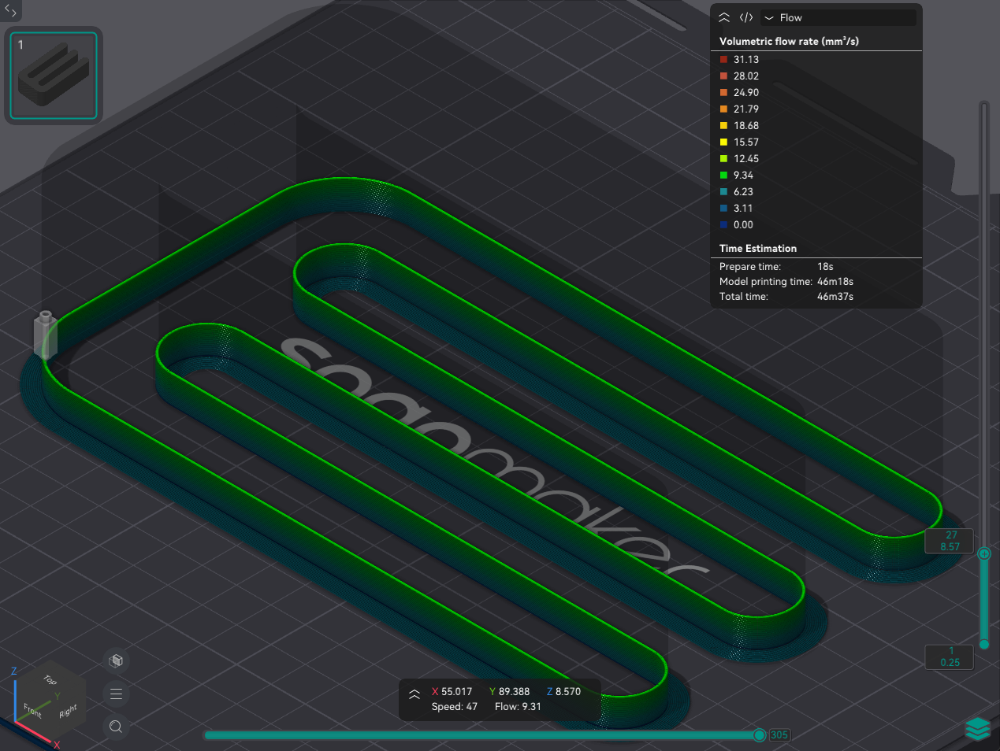
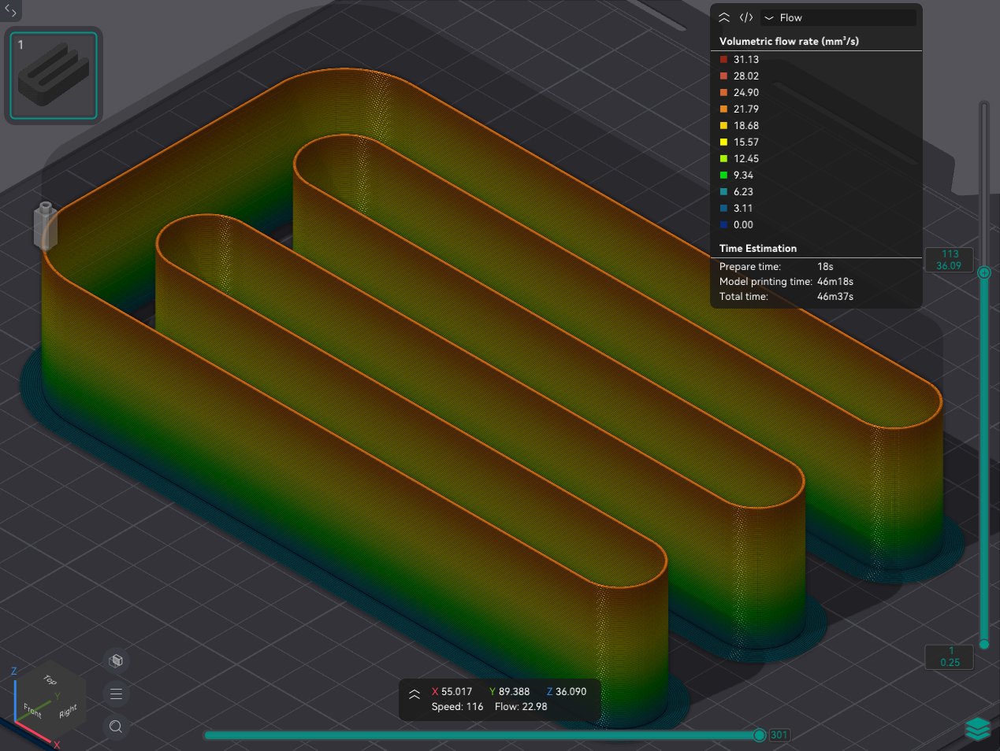
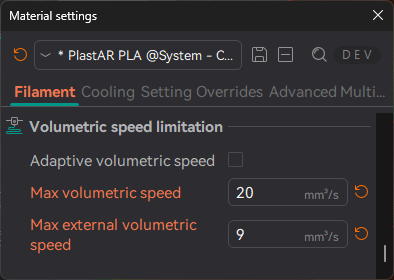

# Max Volumetric Speed (FlowRate) Calibration

[Max Volumetric Speed](material_volumetric_speed_limitation) value varies depending on your **material**, **machine**, **nozzle diameter**, and even your **extruder setup**, so it’s important to calibrate it for your specific printer and each filament you use.

> [!TIP]
> Follow the recommended calibration order in the [Calibration Guide](calibration_guide).

> [!NOTE]
> Even for the same material type (e.g., PLA), the **brand** and **color** can significantly affect the maximum flow rate.

> [!TIP]
> If you're planning to increase speed or flow, it’s a good idea to **increase your nozzle temperature**, preferably toward the higher end of the recommended range for your filament. Use a [temperature tower calibration](temp_calib#nozzle-temp-tower) to find that range.

## Calibration Overview

You will be prompted to enter the settings for the test: start volumetric speed, end volumetric speed, and step. It is recommended to use the default values (5mm³/s start, 20mm³/s end, with a step of 0.5), unless you already have an idea of the lower or upper limit for your filament. Select "OK", slice the plate, and send it to the printer. If the model reaches the top without failing, print it again with a higher end volumetric speed.

## Reading the Results

Once printed, look for three points on the model, from the bottom up:

1. **Gloss lost:** the surface turns from glossy to matte, or its finish gets rougher. This gives the [Max external volumetric speed](material_volumetric_speed_limitation#max-external-volumetric-speed).
2. **Quality lost:** the walls start to deform, usually first at the curves. This gives the [Max volumetric speed](material_volumetric_speed_limitation#max-volumetric-speed).
3. **Failure:** the walls deform badly and the nozzle starts to under-extrude. This is the limit of your hotend with this filament.

> [!TIP]
> A **change in surface sheen** (glossy vs. matte) is often a visual cue of material degradation or poor layer adhesion. Materials that never print glossy show it as a rougher or duller surface.

Use calipers or a ruler to measure the **height** of each point. In this example, the gloss is lost at **8.5mm**, the curves start to deform at **36mm**, and at **40mm** the walls deform badly and under-extrude.

Then turn each height into a volumetric speed in one of these ways:

- Use the following formula

  $$
  Volumetric Speed = start + (HeightMeasured * step)
  $$

  This example was printed with a start of 5mm³/s and a step of 0.5:

    - Gloss lost: `5 + (8.5 * 0.5) = 9.25mm³/s`
    - Quality lost: `5 + (36 * 0.5) = 23mm³/s`
    - Failure: `5 + (40 * 0.5) = 25mm³/s`

- Use OrcaSlicer in the "Preview" tab, make sure the color scheme "Flow" is selected. Move the layer slider to the height that you measured, and click on the toolhead slider. This will show the flow at that height. In this example, the layer at 8.57mm shows 9.31mm³/s and the layer at 36.09mm shows 22.98mm³/s.

## Setting the Values

Set both values in the filament settings, a little below the points you measured:

- **[Max volumetric speed](material_volumetric_speed_limitation#max-volumetric-speed):** below the point where the quality started to drop, with a safety margin (see the note below), and never at the failure point. No line of the print goes above it. In this example, the quality dropped at 23mm³/s, so 20mm³/s is used.
- **[Max external volumetric speed](material_volumetric_speed_limitation#max-external-volumetric-speed):** just below the point where the surface lost its gloss. Outer walls, external bridges and top surfaces that are not ironed stay below it, so they keep that finish while the rest of the print runs at the full flow. In this example, the gloss was lost at 9.25mm³/s, so 9mm³/s is used. It only has an effect when it is below the Max volumetric speed.

> [!NOTE]
> This test is a best case scenario and doesn't take into account Retraction or other settings that can increase clogs or under-extrusion.  
> You may want to reduce the Max volumetric speed by 10%-20% (or even further) to ensure print quality/strength.  
> **Printing at high volumetric speed can lead to poor layer adhesion or even clogs in the nozzle.**
