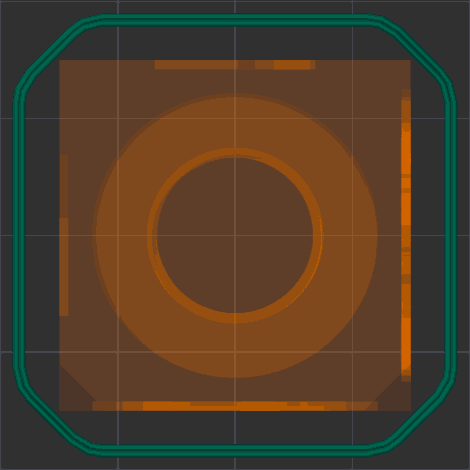
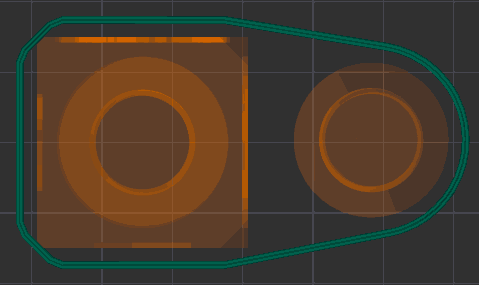
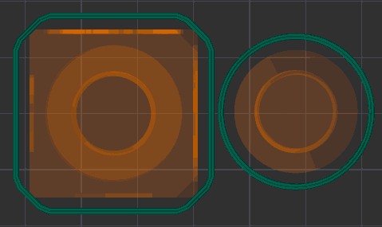

# Skirt

A skirt is one or more additional perimeters printed around the model outline on the first layer(s). It helps prime the hotend, stabilize extrusion before the model starts, and can act as a basic wind/draft shield when built taller.

- [Loops](#loops)
- [Type](#type)
    - [Combined](#combined)
    - [Per object](#per-object)
- [Minimum extrusion Length](#minimum-extrusion-length)
- [Distance](#distance)
- [Start point](#start-point)
- [Speed](#speed)
- [Height](#height)
- [Shield](#shield)
    - [Shield brim width](#shield-brim-width)
    - [Shield fillet width](#shield-fillet-width)
    - [Shield fillet layers](#shield-fillet-layers)
    - [Shield serpentine depth](#shield-serpentine-depth)
    - [Shield serpentine pitch](#shield-serpentine-pitch)
    - [Shield serpentines per corner](#shield-serpentines-per-corner)
    - [Shield speed](#shield-speed)
    - [Shield first layer flow ratio](#shield-first-layer-flow-ratio)
- [Single loop after first layer](#single-loop-after-first-layer)

## Loops

[Mode](option_mode): `Simple`.  
[Variable](built_in_placeholders_variables): `skirt_loops`.  
[Type](option_type#integer-float-percentage): `Integer`.  
[CLI Example](cli_mode#setting-overrides): `--skirt-loops=1`.  
Number of skirt loops to print.  
Usually 2 loops are recommended, but more loops improve priming and give a larger buffer between the nozzle and the part, at the cost of extra filament and time.  
Set to 0 to disable the skirt.

## Type

[Mode](option_mode): `Advanced`.  
[Variable](built_in_placeholders_variables): `skirt_type`.  
[Type](option_type#choice): `Choice`.  
[Options](option_type#choice): `combined, perobject`.  
[CLI Example](cli_mode#setting-overrides): `--skirt-type=combined`.  

### Combined

A single skirt that surrounds all objects on the bed.
  Recommended for general use.

### Per object

Each object gets its own skirt printed separately. Objects close enough for their skirts to overlap share a single skirt.
  Recommended when using [Print sequence by object](others_settings_special_mode#by-object).

## Minimum extrusion Length

[Mode](option_mode): `Advanced`.  
[Variable](built_in_placeholders_variables): `min_skirt_length`.  
[Type](option_type#integer-float-percentage): `Float`.  
[CLI Example](cli_mode#setting-overrides): `--min-skirt-length=1`.  
Minimum filament extrusion length in mm when printing the skirt. Zero means this feature is disabled.  
Using a non-zero value is useful if the printer is set up to print without a prime line.  
The final number of loops is not taken into account when arranging objects or validating the distance between them. Increase the number of loops in that case.

## Distance

[Mode](option_mode): `Advanced`.  
[Variable](built_in_placeholders_variables): `skirt_distance`.  
[Type](option_type#integer-float-percentage): `Float`.  
[CLI Example](cli_mode#setting-overrides): `--skirt-distance=1`.  
Distance from skirt to brim or object.  
Increasing this distance can help avoid collisions with brims or supports, but will increase the footprint of the skirt and filament usage.

## Start point

[Mode](option_mode): `Advanced`.  
[Variable](built_in_placeholders_variables): `skirt_start_angle`.  
[Type](option_type#integer-float-percentage): `Float`.  
[CLI Example](cli_mode#setting-overrides): `--skirt-start-angle=1`.  
Start angle for the skirt relative to the object center. 0° is the right-most position (along the +X axis), angles increase counter-clockwise.  
Use this to control where the skirt begins to better align with part features or prime locations.

## Speed

[Mode](option_mode): `Advanced`.  
[Variable](built_in_placeholders_variables): `skirt_speed`.  
[Type](option_type#integer-float-percentage): `Float`.  
[CLI Example](cli_mode#setting-overrides): `--skirt-speed=1`.  
Printing speed for the skirt in mm/s. Set to 0 to use the [First layer infill](speed_settings_initial_layer_speed#initial-layer-infill) speed on the first layer and the [Support](speed_settings_other_layers_speed#support) speed on higher layers.  
Slower speeds give a more reliable prime; very fast skirt speeds may not adhere properly and come off, causing problems with the part.

## Height

[Mode](option_mode): `Simple`.  
[Variable](built_in_placeholders_variables): `skirt_height`.  
[Type](option_type#integer-float-percentage): `Integer`.  
[CLI Example](cli_mode#setting-overrides): `--skirt-height=1`.  
Number of layers the skirt should be printed for. Usually 1 layer for priming. Increase the height if you want a taller draft shield effect.

## Shield

[Mode](option_mode): `Advanced`.  
[Variable](built_in_placeholders_variables): `draft_shield`.  
[Type](option_type#choice): `Choice`.  
[Options](option_type#choice): `disabled, enabled`.  
[CLI Example](cli_mode#setting-overrides): `--draft-shield=disabled`.  
When enabled, the skirt is printed as a draft shield: a taller wall surrounding the part to help protect prints (especially ABS/ASA) from drafts and sudden temperature changes.  
This is most useful for open-frame printers without an enclosure.

- Enabled: the shield is as tall as the tallest printed model on the bed.
- Disabled: the skirt uses the [Height](#height) value.

> [!NOTE]
> The skirt is printed at the [skirt distance](#distance) from the brim, or from the object if it has no brim, so the draft shield does not intersect brims.

The draft shield of a large ABS part can warp itself: it is a thin wall with a one-line footprint, so it lifts at its corners and tears off the bed. The options below keep it on the bed. They are only available when the shield is enabled.

### Shield brim width

[Mode](option_mode): `Advanced`.  
[Variable](built_in_placeholders_variables): `draft_shield_brim_width`.  
[Type](option_type#integer-float-percentage): `Float`.  
[CLI Example](cli_mode#setting-overrides): `--draft-shield-brim-width=5`.  
Width of a brim printed on the first layer around the outside of the draft shield. It widens the shield's footprint on the bed, while the shield keeps its number of walls above the first layer.  
The brim is cut at the edge of the bed (and at excluded bed areas), so a wide brim also works when the part is large.  
Set to 0 to disable.

### Shield fillet width

[Mode](option_mode): `Advanced`.  
[Variable](built_in_placeholders_variables): `draft_shield_fillet_width`.  
[Type](option_type#integer-float-percentage): `Float`.  
[CLI Example](cli_mode#setting-overrides): `--draft-shield-fillet-width=1.5`.  
Width of a stepped fillet between the draft shield and its brim. Without it, the shield can tear off its one-layer brim at the 90° step. Above the first layer, the brim loops next to the shield are printed again, fewer on each layer, until only the shield is left.  
Limited to the [shield brim width](#shield-brim-width). 1 to 2 mm is usually enough. Set to 0 to disable.

### Shield fillet layers

[Mode](option_mode): `Advanced`.  
[Variable](built_in_placeholders_variables): `draft_shield_fillet_layers`.  
[Type](option_type#integer-float-percentage): `Integer`.  
[CLI Example](cli_mode#setting-overrides): `--draft-shield-fillet-layers=3`.  
Number of layers above the first layer over which the [fillet](#shield-fillet-width) narrows down to the shield. 2 to 3 layers are usually enough.

### Shield serpentine depth

[Mode](option_mode): `Advanced`.  
[Variable](built_in_placeholders_variables): `draft_shield_serpentine_depth`.  
[Type](option_type#integer-float-percentage): `Float`.  
[CLI Example](cli_mode#setting-overrides): `--draft-shield-serpentine-depth=6`.  
How far outward serpentines in the long sides of the draft shield reach, next to its sharp corners.  
A long shield side shrinks while it cools and pulls the corners at its ends off the bed. A serpentine of U-turns next to the corner works as a soft expansion joint: its legs stand across the side and bend, so the pull does not reach the corner.

- Long sides are straight sides of at least a third of the longest one. Short end sides get no serpentines.
- A corner is everything between two long sides, short sides and rounded ends included. If it turns by 30° or more, both long sides get serpentines next to it. Shallow bends stay straight.
- The serpentines only reach outward, so the shield never gets closer to the object. All shield walls, the brim and the fillet follow them.

At least half the [serpentine pitch](#shield-serpentine-pitch) is used. Set to 0 to disable.

### Shield serpentine pitch

[Mode](option_mode): `Advanced`.  
[Variable](built_in_placeholders_variables): `draft_shield_serpentine_pitch`.  
[Type](option_type#integer-float-percentage): `Float`.  
[CLI Example](cli_mode#setting-overrides): `--draft-shield-serpentine-pitch=6`.  
Length along the shield side of one serpentine period (out and back). Its U-turns have a radius of a quarter of the pitch, so the legs stand half the pitch apart.

### Shield serpentines per corner

[Mode](option_mode): `Advanced`.  
[Variable](built_in_placeholders_variables): `draft_shield_serpentine_count`.  
[Type](option_type#integer-float-percentage): `Integer`.  
[CLI Example](cli_mode#setting-overrides): `--draft-shield-serpentine-count=2`.  
Number of serpentine periods next to each sharp corner of the draft shield. Fewer are used where the side is too short.

### Shield speed

[Mode](option_mode): `Advanced`.  
[Variable](built_in_placeholders_variables): `draft_shield_speed`.  
[Type](option_type#integer-float-percentage): `Float`.  
[CLI Example](cli_mode#setting-overrides): `--draft-shield-speed=150`.  
Speed of the draft shield walls above its first layer and its [fillet layers](#shield-fillet-layers), in mm/s. These bottom layers keep the [skirt speed](#speed) for good adhesion, the fillet included. A tall shield printed at the skirt speed on every layer can add a lot of print time.  
Set to 0 to use the skirt speed on all layers.

### Shield first layer flow ratio

[Mode](option_mode): `Advanced`.  
[Variable](built_in_placeholders_variables): `draft_shield_first_layer_flow_ratio`.  
[Type](option_type#integer-float-percentage): `Float`.  
[CLI Example](cli_mode#setting-overrides): `--draft-shield-first-layer-flow-ratio=1.1`.  
Flow ratio of the first layer of the draft shield, its walls and its brim. A little over-extrusion, such as 1.1, fuses the lines so the first layer does not split while the shield pulls on it. Other layers are not changed.  
The [brim flow ratio](others_settings_brim#brim-flow-ratio) applies to the shield brim as well.

## Single loop after first layer

[Mode](option_mode): `Advanced`.  
[Variable](built_in_placeholders_variables): `single_loop_draft_shield`.  
[Type](option_type#boolean): `Boolean`.  
[CLI Example](cli_mode#setting-overrides): `--single-loop-draft-shield=1`.  
When enabled, limits the skirt or draft shield to a single wall after the first layer (i.e. only one loop is printed on subsequent layers). This reduces filament and print time but makes the shield less robust and more prone to warping or cracking.
